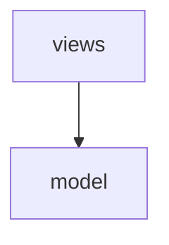

# ADR-001: layers point down

## Context

The model must not import the views.

## Decision

Imports point from views to model only.

## Diagram

## Consequences

- a view can be replaced without touching the model

## Enforcement

The check is `src/layers.py:2`.
