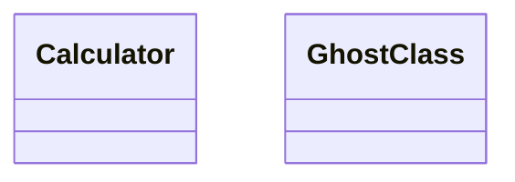

# Bug 0290: a code block nested in a list item or blockquote never reaches `codeBlocks`, so a nested diagram is never checked

## Status

- **State:** Fixed — 2026-10-14 on `fix/0290-nested-code-blocks`; see `## Fixed`.
- **Severity:** **High**, a **fail-open**. eess-crossvalidate's md↔mermaid binding (`embeddedDiagramsMatchCode`) passes a diagram that names a class the code does not have, whenever the diagram sits inside a list item or a blockquote. The nested document also never counts toward the diagram statistics. The md↔mermaid-er binding reads the same list, so it follows by construction; it was not measured.
  _Corrected 2026-10-14, at the fix:_ the ER binding is now measured, red on `main` for a list item
  and a blockquote. And the silent pass needs another diagram examined in the same run: a run whose
  only diagram is nested goes red with `emitter/pass-without-evidence` (zero examined) — which is why
  the reproduction runs each document beside `good.md`.
- **Origin:** self-found · design review of a fence-handling fix
- **Reported:** 2026-09-13

## Symptom

`buildDocument` collects code blocks from the root's direct children only. The loop and the push were in `buildDocument` in `packages/md/src/model/document.ts` (as of `2a2a503`; the line numbers first written here had drifted before the fix and are dropped).

The md↔mermaid bindings read nothing else:

- `packages/crossvalidate/src/md-mermaid.ts:189`
- `packages/crossvalidate/src/md-mermaid.ts:223`
- `packages/crossvalidate/src/md-mermaid-er.ts:58`

Neither the type's documentation nor the markdown guide says the list is top-level only.

## Reproduce

The fixture is a copy of `packages/crossvalidate/tests/fixtures/calc`, with its `embedded-good.md` as `good.md`. Each document under test runs beside `good.md` through `embeddedDiagramsMatchCode(corpus, project)`, on `main` at `2a2a503`.

````text
top-bad.md
# Top



list-bad.md
# List

- The design:

  ```mermaid
  classDiagram
  class Calculator
  class GhostClass
  ```

quote-bad.md
# Quote

> ```mermaid
> classDiagram
> class Calculator
> class GhostClass
> ```

list-good.md
# Valid nested

- The design:

  ```mermaid
  classDiagram
  class Calculator
  class AddOperation
  ```
````

| Document     | Finding                         | `embeddedDiagramStats` on the document alone |
| ------------ | ------------------------------- | -------------------------------------------- |
| top-bad.md   | `GhostClass` reported at line 3 | 1 document, 1 diagram                        |
| list-bad.md  | **none**                        | **0 documents, 0 diagrams**                  |
| quote-bad.md | **none**                        | **0 documents, 0 diagrams**                  |
| list-good.md | none (correct)                  | 0 documents, 0 diagrams                      |

**This repository cannot see it.** It has no nested mermaid blocks, against 34 at top level across the whole repository, fixtures included, so dogfooding exercises none of this.

## The corruption that must produce a violation

A diagram that names a class absent from code must be reported wherever it sits: at top level, in a list item, or in a blockquote. Its document must count toward the statistics, and a valid nested diagram must add no finding.

## Measured facts for a fix

- **A spike, not kept.** On a branch whose document model is identical to `main`'s, a spike collected code nodes from every descendant.
  - The nested diagram was reported.
  - The eess-md and eess-crossvalidate suites passed.
  - The diagram, crossval, corpus and family gates were green.
- **Nothing pins nesting in either direction.** Adding the deep walk left both suites green.
- **Why it is a break.** Nested blocks entering `codeBlocks` is a behavioural break for md-mermaid and md-mermaid-er adopters, who gain findings, so eess-md's changeset must name eess-crossvalidate ([bug 0185](./0185-a-kernel-break-reaches-adopters-as-a-dialect-patch.md)).
  _Corrected at the fix:_ [bug 0185](./0185-a-kernel-break-reaches-adopters-as-a-dialect-patch.md) is about regular dependencies; crossvalidate takes eess-md as an
  optional peer, which RELEASING.md does not require naming. It is named anyway, so its changelog
  records the break its adopters see.

## Verification ledger

- [x] Nested bad diagrams, in a list item and in a blockquote, pass on `main`; the top-level control is reported; a valid nested diagram adds no finding.
- [x] Nested documents count as 0 in the statistics.
- [x] Red tests: `list-bad.md` and `quote-bad.md` are reported through both md↔mermaid bindings; `list-good.md` adds nothing; the nested document counts toward the statistics. _Done-otherwise:_ the ER binding has its own fixtures for the two shapes (`bad-nested-extra-attribute.md`, `bad-quoted-extra-attribute.md`), since it needs a property table.
- [x] The fix.
- [x] A non-vacuity row on the nested shape.

Deferred: none.

## Fixed — 2026-10-14

`buildDocument` now collects code nodes at every depth, in document order (`collectCode`,
`packages/md/src/model/document.ts:110`). The headings and tables loop is unchanged: tables nested
in a list stay [bug 0292](../0292-a-table-nested-in-a-list-never-reaches-the-model.md)'s.

**Tests, red first through the public entry points.**

- `packages/crossvalidate/tests/md-mermaid.test.ts`, four tests. A ghost class in a list item and in a
  blockquote, each reported at its fence line (5 and 3). A valid nested diagram adds no finding. The
  three nested documents count as 3 documents and 3 diagrams.
- `packages/crossvalidate/tests/md-mermaid-er.test.ts`, two tests: an ER attribute missing from the
  table, in a diagram inside a list item and inside a blockquote, each at its fence line (14 and 12).
- `packages/md/tests/code-blocks.test.ts`, one test: blocks at the top level, in a list item, in a
  blockquote and two lists deep, with lang, fence line and value. This is the first test that pins
  nesting in eess-md itself.

All seven were red with the top-level-only loop put back (the sabotage below). The one asserting a
valid nested diagram adds no finding was red through the evidence floor: the model read zero
diagrams, so the rule threw `emitter/pass-without-evidence`.

**Non-vacuity.** `scripts/nonvacuity/bad-md-mermaid/nested-diagram.md` is case 7 of the
`crossval/md-mermaid` row. It asserts the ghost class at fence line 10.

**Sabotage, measured.** With the top-level-only loop put back:

- the row exits 0 and names the miss;
- the six crossvalidate tests and the eess-md test go red.

Restored, all pass again.

**This repository.** Nothing here changes. `check:crossval`'s md↔mermaid gate reads 1 diagram in
1 document, a top-level one. Across the 438 tracked `.md` files under `work/`, `adr/` and `docs/`,
mdast finds 4 `mermaid` code nodes at the top level and **0 nested** (measured 2026-10-14 on this
branch: `fromMarkdown` with GFM over `git ls-files 'work/*.md' 'adr/*.md' 'docs/*.md'`, counting `code` nodes with
lang `mermaid` by depth). [Proposal 006](../../proposals/006-mermaid-beyond-classdiagram.md)'s review counted "3 nested"; those were this record's own
reproduction, text inside a ` ````text ` fence, and that proposal carries a dated correction.

**Release.** eess-md `minor`, marked breaking: a nested block now reaches `codeBlocks`, so an
md↔mermaid or md↔mermaid-er rule can report findings it never saw before. eess-crossvalidate is
named at `minor` by choice, not by rule: it takes eess-md as an optional peer, which RELEASING.md
does not require naming. Naming it puts the break in the changelog of the package whose rules report
the new findings.

## Related

- [0289](../0289-a-fence-its-container-closes-hides-the-next-line.md): the same model, misreading where a block ends.
- [0292](../0292-a-table-nested-in-a-list-never-reaches-the-model.md): the same loop, for tables.
